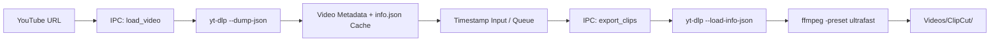

# ClipCut

ClipCut is a cross-platform desktop application for extracting timestamped video segments from YouTube URLs. It packages `yt-dlp` and `ffmpeg` as isolated sidecar binaries, executing localized stream cuts without requiring external runtime dependencies or command-line setup.

---

## Downloads

Official release packages are built for Windows and Linux on `x86_64` architectures:

| Platform | Package Format | Distribution File |
|---|---|---|
| **Linux (x86_64)** | AppImage (Standalone) | `ClipCut_<version>_amd64.AppImage` |
| **Linux (x86_64)** | Debian / Ubuntu Package | `clipcut_<version>_amd64.deb` |
| **Windows (10 / 11)** | NSIS Installer | `ClipCut_<version>_x64-setup.exe` |

Binary downloads and release notes are published under [GitHub Releases](https://github.com/sea-deep/clipcut/releases).

---

## Key Capabilities

- **Partial Range Streaming**: Queries HTTP Range headers through `yt-dlp --download-sections` and `ffmpeg` to download only the frames required for the specified cut points, avoiding full video file downloads for short clips.
- **Pre-fetched Metadata Caching**: Serializes format descriptors to `info.json` upon video discovery, bypassing YouTube HTML parsing and JavaScript challenge solving during export.
- **Quality Presets**:
  - `Highest`: Selects the maximum resolution stream available (up to 4K / 1080p).
  - `1080p`: Constrains video height to 1080p.
  - `720p`: Restricts stream height to 720p for reduced download payload.
  - `480p` / `360p`: Leverages lower bitrate formats for rapid extraction.
- **Container Output Formats**: Supports muxing to MP4, WebM, and MKV.
- **Asynchronous Export Queue**: Non-blocking queue interface positioned beneath the export controls, displaying per-job transfer percentages, cancellation controls, and file manager shortcuts upon completion.
- **Flexible Timestamp Formats**:
  - Raw integers: `15` normalizes to `00:15`.
  - Minutes and seconds: `1:20` normalizes to `01:20`.
  - Hours, minutes, and seconds: `1:02:15`.
  - Multi-line clipboard paste: Pasting strings like `0:15-0:30\n0:45-1:10` automatically populates the queue entries.
- **Libadwaita Interface**: Built with vector SVG iconography, high-contrast monochrome tokens, and system dark/light theme switching.

---

## Output Organization

Exported clips are stored by default in the system videos directory:

```
Videos/ClipCut/
└── <Sanitized_Video_Title>/
    ├── 01_00-15_00-30.mp4
    ├── 02_00-45_01-10.mp4
    └── 03_02-15_03-00.mp4
```

The output destination folder can be changed at any time via the file picker dialog in the Output section.

---

## Keyboard Shortcuts

| Shortcut | Context | Action |
|---|---|---|
| `Tab` | Start time field | Focuses End time field |
| `Enter` | Start time field | Moves cursor to End time field |
| `Enter` | End time field | Commits clip to list and resets fields |
| `Ctrl + Enter` / `Cmd + Enter` | Anywhere | Triggers export with all queued clips |
| `Escape` | Timestamp fields | Clears field focus |

---

## Architecture

The project consists of a Tauri 2 desktop shell combining a native Rust backend with a Vite frontend:

```
clipcut/
├── src/                         # Frontend application
│   ├── assets/                  # Application icons and branding SVGs
│   ├── styles/main.css          # Libadwaita stylesheet and theme variables
│   ├── index.html               # Main application shell
│   ├── main.ts                  # DOM lifecycle, event delegation, queue manager
│   ├── state.ts                 # Domain models and application store types
│   └── timestamps.ts            # Timestamp validation, formatting, and parser logic
├── src-tauri/                   # Rust backend
│   ├── Cargo.toml               # Backend dependencies and release profiles (LTO, strip)
│   ├── tauri.conf.json          # Window geometry, sidecars, and bundle definitions
│   ├── binaries/                # Platform sidecars (yt-dlp, ffmpeg, ffprobe)
│   └── src/
│       ├── lib.rs               # Tauri application initialization and plugin registration
│       ├── clip.rs              # Clip domain structs, QualityOption, and serialization
│       ├── commands/mod.rs      # IPC command handlers (load_video, export_clips, cancel)
│       ├── download.rs          # yt-dlp execution engine, cache loader, and progress parser
│       ├── export.rs            # Export pipeline coordinator and strategy selector
│       ├── paths.rs             # Cross-platform path resolution and filename sanitization
│       └── error.rs             # Strongly typed error hierarchy
└── scripts/
    └── download-sidecars.sh     # Sidecar downloader for Linux and Windows targets
```

### Data Flow



---

## Building from Source

### 1. Prerequisites

#### Linux (Arch Linux / Manjaro)
```bash
sudo pacman -S --needed base-devel webkit2gtk-4.1 gtk3 nodejs npm rust
```

#### Linux (Debian / Ubuntu 22.04+)
```bash
sudo apt update && sudo apt install -y \
  build-essential \
  libwebkit2gtk-4.1-dev \
  libgtk-3-dev \
  libappindicator3-dev \
  librsvg2-dev \
  patchelf \
  nodejs \
  npm \
  rustc \
  cargo
```

#### Windows (10 / 11)
- [Node.js](https://nodejs.org) (v20 or v22 LTS)
- [Rust toolchain](https://rustup.rs) (`stable-x86_64-pc-windows-msvc`)
- Visual Studio C++ Build Tools (with Desktop development with C++)

### 2. Sidecar Provisioning

ClipCut requires sidecar executables in `src-tauri/binaries/`. Download the pinned sidecars for your platform:

```bash
# Automatically detects current host architecture:
bash scripts/download-sidecars.sh

# Or target Windows explicitly:
bash scripts/download-sidecars.sh x86_64-pc-windows-msvc
```

### 3. Development Server

```bash
npm install
npm run tauri dev
```

### 4. Production Release Build

To produce an optimized production binary with Link-Time Optimization (LTO) and binary stripping:

```bash
npm run tauri build
```

Compiled bundle artifacts will be written to:
- **Linux**: `src-tauri/target/release/bundle/appimage/` and `src-tauri/target/release/bundle/deb/`
- **Windows**: `src-tauri/target/release/bundle/nsis/`

---

## Verification & Tests

To execute the test suite across both frontend and backend:

```bash
# Run all tests (Vitest + Cargo test):
npm test

# Run frontend TypeScript unit tests:
npm run test:ts

# Run Rust unit tests:
npm run test:rust

# Verify TypeScript type checks:
npm run check:ts
```

---

## License

This project is licensed under the MIT License — see the [LICENSE](LICENSE) file for details.
